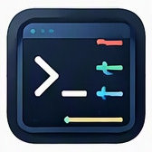

# cli_args

<p align="center">
  
</p>

[Icon](docs/brand/icon.png) · [Favicon](docs/brand/favicon.png)

A single-file, standard-library-only Python toolkit for reusable CLI argument definitions, validation, command construction, execution, and JSON/text output, backed by practical CLI tests.

Python 3.10+。`cli_args.py` をコピーして取り込めます。本体は標準ライブラリだけで動き、import時に引数解析・コマンド実行をしません。pipパッケージ化は初期版の対象外です。

## 引数定義を再利用する

`argparse` の `choices` / `required` / `nargs` / `action` / `type` をそのまま利用します。既定ではオプション名の省略を禁止します。

```python
import argparse
from cli_args import Argument, parse_args

args = parse_args([
    Argument(("--mode",), {"choices": ("read", "convert"), "required": True}),
    Argument(("--enabled",), {"action": argparse.BooleanOptionalAction}),
    Argument(("files",), {"nargs": "+"}),
], ["--mode", "read", "--no-enabled", "a.html", "b.html"])
```

細かい設定には `make_parser()` の戻り値へ直接 `add_argument()` や `add_mutually_exclusive_group()` を使えます。`Argument.names`、明示指定する `parse_args(..., argv=...)`、`require_when(..., required=...)` はいずれも順序を持つ有限の sequence を契約とし、単一文字列や set/dict/generator の暗黙展開を拒否します。`require_when(parser, args, when=..., required=["output"])` は条件が成立したとき、値が `None` の項目を `parser.error()` で拒否します。`False` や `0` は指定値として扱います。

`add_output_arguments(parser)` は `--format text/json` と `--output`、`add_execution_arguments(parser)` は `--dry-run` / `--timeout` / `--cwd` を追加します。必要なセットだけ選び、呼び出し側で名前の衝突を避けてください。

## コマンドを組み立てる

```python
from cli_args import Command, run_command, write_output

command = (Command(("git",))
    .option("-C", "/path/to/repository")
    .positional("status")
    .flag("--short"))
result = run_command(command, timeout=10)
write_output(result, format="json")
```

| メソッド | 動作 |
|---|---|
| `flag(name, enabled)` | boolがTrueのときだけ追加 |
| `option(name, value)` | 名前と値を追加。Noneは省略、空文字は保持 |
| `option(..., attached=True)` | `--name=value` を追加。実行先が対応する場合に使用 |
| `repeated(name, values)` | `-H value1 -H value2` のように繰り返す。`values` は複数トークンの collection 専用 |
| `multiple(name, values)` | `--files a b` のように並べる。`values` は複数トークンの collection 専用 |
| `positional(*values)` | 指定順に位置引数を追加 |
| `passthrough(values, separator=False)` | argv をそのまま追加。`separator=True` のときだけ先頭に `--` を追加。`values` は複数トークンの collection 専用 |

コマンドごとの意味や有効な組み合わせは呼び出し側で定義します。引数は文字列またはテキストパスで渡し、数値は明示的に文字列化します。シェル展開・引用符の解釈・文字列の分割は行いません。`repeated()` / `multiple()` / `passthrough()` の collection 引数は、順序を持つ有限の `Sequence`（list/tuple等）専用です。単一の `str` / `PathLike` に加え、順序が不定な set/dict や一度きりの generator も `TypeError` で拒否します。argvの順序・再現性をAPI契約にするためです。1トークンだけ追加したい場合は `option()` / `positional()` を使います。

`pytest_command(paths, quiet=True, tb="short", summary=True, extra=[...])` は `python -m pytest -q --tb short -ra ...` を構築する任意のプリセットです。`paths` と `extra` も順序を持つ有限の `Sequence` 専用で、単一の `str` / `PathLike`、set/dict、generator は拒否します。pytestを本体からimportせず、自動インストールもしません。

## Node.js を argv から実行する

`node_command(target, *args, node=None, node_flags=())` は `[node, *node_flags, target, *args]` を構築します。`run_node(...)` は `run_command()` の薄いラッパで、`timeout` / `max_output_bytes` / `env` / `dry_run` など既存の実行契約をそのまま使えます。`dry_run=True` のときは `node --version` の probe も子プロセス起動も行わず、探索順に沿った argv[0] トークン（最後は字面 `node`）だけを組み立てます。`is_node_target(path)` は `.js` / `.cjs` / `.mjs` を判定します。`node_or_command([])` は `Command(())` と同様に `ValueError` です。

Node の探索順は次のとおりです。`node=` 引数、`--node`、`CLI_ARGS_NODE` は**明示指定**で、失敗時にフォールバックしません。その後 `NODE` 環境変数、`shutil.which('node')` を試します。Windows の `.cmd` / `.bat` ラッパは拒否し、見つかった実行ファイルは `node --version` を 5 秒以内に一度だけ確認し、Node 18 以上であることを要求します（`dry_run` 時は probe を省略）。見つからない・古い・タイムアウトは `NodeNotFoundError`（`FileNotFoundError` のサブクラス、メッセージは `cli_args: node …`）です。子プロセスの終了コードは `returncode` にそのまま載ります。`shell=True` は使いません。

CLI から opt-in する場合は `add_node_arguments(parser)` で `--node PATH` と繰り返し `--node-flag`（値が `-` で始まるときは `--node-flag=--import=x` の形）を追加し、実行 argv を組み立てる直前で `node_or_command(argv, node=args.node, node_flags=args.node_flags)` を呼びます。`.js` / `.cjs` / `.mjs` が先頭トークンのときだけ Node で包み、それ以外は `Command(argv)` をそのまま返します。既存の argv 意味は、このヘルパを使わない限り変わりません。

```python
from cli_args import node_command, run_node, node_or_command

result = run_node("tools/probe.cjs", "--", "-flag", "", "日本 語", timeout=30)
command = node_or_command(["playwright.cjs", "test", "--list"], node_flags=["--no-warnings"])
```

## Node.js から `cli_args.py` を呼ぶ

Python 側の `run_command` / `render_output` を Node 18+ から使うときは、リポジトリ直下の `cli_args.cjs` を require します。実装は親リポジトリ `myon-bioinformatics` の共有ランチャー `vendor/py_launch.cjs` 経由で `cli_args.py run` / `render` を起動するだけで、Node から Node を起動しません。`shell: true` は使いません。

| 探索 | 意味 |
|---|---|
| `opts.python` / `runCommand(..., { python })` | 明示指定（失敗時フォールバックなし） |
| `CLI_ARGS_PYTHON` | 明示の環境変数（`py_launch` の `envVar`） |
| `PYTHON` → `python3` → `python`（Windows は `py -3`） | 自動探索 |

```javascript
const {runCommand, render} = require("./cli_args.cjs");

const result = runCommand(["git", "status", "--short"], {cwd: "/path/to/repo", timeout: 30});
console.log(result.returncode, result.stdout, result.stdout_b64);

const text = render({title: "日本語"}, "json");
```

CLI として直接実行する場合は `node cli_args.cjs run`（stdin に JSON）や `node cli_args.cjs render --format json`（stdin に値）と同じ契約です。不正な JSON や未知フィールドは Python が exit 2 で返し、ライブラリ API では `CliArgsRequestError` になります。インタプリタ起動失敗は `cli_args Python process failed: …` です。

**挙動変更（#27）:** Node の `runCommand` で `opts.max_output` を省略すると、Python へ **常に** `max_output: CLI_RUN_DEFAULT_MAX_OUTPUT_BYTES`（4 MiB）が送られます。以前の Node ラッパーは非制限に近い動きでしたが、橋渡しでは子の stdout/stderr 合計を 4 MiB で切ります。より大きい出力は `opts.max_output`（最大 `CLI_RUN_MAX_OUTPUT_BYTES`、8 MiB）を明示してください。直接 `python -S cli_args.py run` は従来どおり `max_output` 省略で非制限です。

Node は `response_max_bytes: CLI_RUN_RESPONSE_MAX_BYTES`（96 MiB）を `run` リクエストに付け、Python が **実際にシリアライズした JSON の UTF-8 長**をその上限と照合してから stdout に書きます。超過時は終了 **1**（stderr に `response exceeds response_max_bytes`）。Node の `maxBuffer` は `CLI_RUN_RESPONSE_MAX_BYTES + CLI_HOST_RESPONSE_MARGIN_BYTES` のみ（サイズの推定式は使いません）。`render` も `--response-max-bytes CLI_RENDER_RESPONSE_MAX_BYTES` と同じ照合・同じ `maxBuffer` 契約です。`run` の JSON には `output_limited` を常に含めます（`false` も省略しません）。

## stdin入力を明示的に渡す（他repo横断で回収）

`run_command(command, stdin=...)` は任意の **str（UTF-8へ符号化）またはbytes（無変換）** を一度だけ子プロセスに渡します。末尾の改行は追加しません。shellは使いません。`None` は入力指定なしです。

```python
from cli_args import Command, run_command
import sys

# Flutter等のJSON stdinワーカー。生成したJSON文字列をそのまま渡す。
result = run_command(
    Command((sys.executable, "-S", "worker.py")),
    stdin='{"operation":"inspect","values":["日本語"]}',
    timeout=5,
)
assert result.returncode == 0

# GitのNUL-safe pathspec。空白や先頭 - のある名前を正確に送る。
git = Command(("git", "add", "--pathspec-from-file=-", "--pathspec-file-nul"))
result = run_command(git, stdin=b"-leading name.txt\0", timeout=10)
```

`run_command()` は同期・有限入力のみを扱い、stdinにファイルオブジェクトやiteratorは受け付けません。streaming/bidirectional batch protocolや長時間常駐プロセスには対応しません。dry-run時は型・UTF-8符号化を検証しますが、入力の中身を出力して秘密情報を漏らすことはしません。stdout/stderrの既存UTF-8 replacement policyとexit/timeout契約は変更しません。

横断調査の実例：`flutter_navigation_basic` の標準入力JSON、`browser-test-kit` のstdinベースの子プロセステスト、`gh_identity` 等の外部CLIラッパー。引数解析・固有ドメインルール自体は各プロジェクトに残します。GitのNUL pathspecおよび有限の `git cat-file --batch-command --buffer -Z` 呼出しは **実Git検証済み** です。ただし対話的・長時間常駐する双方向セッションは未対応です。

## 出力保護とバイト上限

`write_output(..., overwrite=False)` は**既存のパスを上書きしない**ためのopt-inです。既存ファイル、シンボリックリンク、リンク切れシンボリックリンクに対して `FileExistsError` を返し、対象を削除しません。出力内容を事前にレンダリングし、出力先と同じディレクトリに一時保存してから排他的なハードリンクで公開します。既定 `overwrite=True` の従来動作は維持します。ハードリンク非対応のファイルシステムでは安全側に失敗します。新規パスの可視化は原子的ですが、クラッシュ耐久性・fsync・公開後の第三者変更防止・既存ディレクトリの自動作成は保証しません。

`run_command(..., max_output_bytes=N)` は stdout/stderr の**合計生バイト数**を上限として捕捉し、超過したら子プロセスを停止します。メモリ上に保存する出力は合計Nバイト以下で、`CommandResult.output_limited=True`、`returncode=None` により通常の成功と区別します。既定 `None` は以前の非制限モードです。省略時の既存JSON形式も維持します。超過時は表示がUTF-8文字の途中で切れる場合があり、decodeは既存どおり `errors="replace"` です。監視対象は起動した子プロセスのみで、子孫プロセス全体の停止は保証しません。

```python
result = run_command(Command(("git", "status")), max_output_bytes=65536, timeout=10)
if result.output_limited:
    raise RuntimeError("command output exceeded limit")
write_output({"ok": True}, format="json", output="result.json", overwrite=False)
```

`examples/run_cli.py` は `--max-output-bytes N`、`--no-overwrite`、`--stdin TEXT` / `--stdin-file PATH`（排他）、`--env KEY=VALUE`（複数指定可）を公開します。出力超過は **exit 125**、タイムアウトは従来どおり **124**、ファイル作成不可やstdinファイル読み込み不可は **1** です。入力はCLI側の`--`より前、外部コマンドargvは後ろです。

## 長い出力を読む側に渡す（省略の明示・pytestの決定行）

`trim_output(text, head=40, tail=40)` は先頭 `head` 行と末尾 `tail` 行を残し、間に `... N line(s) omitted ...` の1行を入れます。`head`/`tail` で切った出力は欠けていても完全に見えるため、読む側（人やエージェント）が欠落に気づけるよう省略を明示します。収まる出力はそのまま返します。

`pytest_summary(output)` は pytest の捕捉出力から結果を決める行だけを返します: 最終行 `N failed, M passed in Xs`（`summary`/`counts`）、`-ra` の `FAILED`/`ERROR` 行（`failed`/`errors`）、pytest-cov の `TOTAL` 行と `Required test coverage` の判定（`coverage`）、各失敗の最初の `E` 行や `INTERNALERROR` を含む `deciding_lines`（既定60行、超過は `truncated`）。

```python
result = run_command(pytest_command(["tests"], quiet=True, summary=True), timeout=600)
digest = pytest_summary(result.stdout)
print(digest["summary"], digest["failed"], digest["coverage"]["required_met"])
print(trim_output(result.stdout, head=20, tail=40))
```

## 実行・出力

```bash
python -S examples/run_cli.py --format json --dry-run -- git status --short
python -S examples/run_cli.py --format json --output result.json --timeout 30 -- python -m pytest -q --tb=short -ra
```

`cli_args.py` 自体にも、Node 等のホストから `python -S cli_args.py` で呼べる機械向け入口があります（import 時は argv を解析しません）。

| サブコマンド | 入力 | 出力 |
|---|---|---|
| `run` | stdin に JSON リクエスト | `CommandResult` を JSON で stdout |
| `render --format text\|json` | stdin に任意の JSON 値 | `render_output` の結果を stdout |

`run` の JSON オブジェクトは `argv`（必須）に加え、任意で `timeout` / `cwd` / `env` / `input` / `max_output` / `dry_run` を受け取ります。stdin は UTF-8 で **4 MiB** まで（超過・非 UTF-8・`NaN`/`Infinity` を含む JSON は終了 **2**）。未知キー・型不一致・不正 JSON も終了 **2**（stderr 1行）。リクエストを処理できた場合は終了 **0** で、子プロセスの終了コードは JSON の `returncode` に入ります。実行ファイル不在や `cwd` 不存在などの**起動失敗**は **1** です。`shell` は受け付けません。

`run` の JSON には、ライブラリの `render_output` とは別に、捕捉した生バイト列の **Base64** フィールド `stdout_b64` / `stderr_b64` を常に付けます。`output_limited` は常に `true` / `false` で返します（CLI のみ。ライブラリの `render_output` JSON は従来どおり `false` のとき省略）。`stdout` / `stderr` は UTF-8 として解釈し、不正バイトは U+FFFD に置換したテキストです。バイナリや非 UTF-8 を欠損なく扱う場合は `*_b64` を使います。`--version` は `cli_args.py` 内の `__version__` 定数（vendor 単体コピーでも同じ値）を表示します。

```bash
printf '%s' '{"argv":["python","-c","print(1)"],"dry_run":true}' | python -S cli_args.py run
printf '%s' '{"argv":["日本語"],"returncode":0,"stdout":"","stderr":"","executed":true}' | python -S cli_args.py render --format json
```

ラッパー引数と実行先引数は必須の `--` で区切ります。実行先の `--format` などは境界の後ろに置けます。

- 実行結果: `argv`, `returncode`, `stdout`, `stderr`, `executed`, `timed_out`。
- 非ゼロ終了も結果として返します。起動失敗は `OSError`、タイムアウトは `timed_out=True` / `returncode=None` と途中出力を返します。
- dry-runは実行せず、`executed=False` / `returncode=None` を返します。成功実行とは区別します。
- JSONは実行結果の封筒です。Git・curl等のstdoutを自動で業務データに変換しません。
- textの実行結果はstdoutそのままです。`run_command()` が捕捉したstdout/stderrはUTF-8 decodeのみ行い、子プロセスが出した改行 (`\n` / `\r\n`) は正規化しません。ライブラリ利用者はstderrと終了状態を確認してください。例のCLIはstderrも表示し、非ゼロ終了を伝え、タイムアウト124・実行ファイル不在127で終了します。`--output` の書込みに失敗した場合（親ディレクトリ不存在・権限不足等）は traceback を出さず `failed to write output: ...` をstderrへ出して終了1にします。
- 保存はUTF-8・LF (`\n`) 固定・既存ファイル上書きです。Windowsを含め改行バイトをLFに固定します。親ディレクトリは作成しません。JSON変換に成功してから書き込みますが、原子的な保存ではありません。
- 既定の非制限実行は出力をメモリに保持します。大量出力は `max_output_bytes` の明示指定で制限できます。バイナリのlossless出力、対話的stdin、ストリーミング、子孫プロセス全体の停止は対象外です。
- `env` 指定は環境全体の置換です。継承する場合は呼び出し側で `os.environ` と合成するか、`build_env(extra, inherit=True)` ヘルパーを利用してください。`build_env()` は Mapping または `"KEY=VALUE"` 文字列の sequence を受け取り、環境変数を安全に合成します。

## 標準ライブラリを第3のCLI面として使う

外部CLIを追加する前に、Python標準ライブラリの `python -m` / `python -c` / 通常importで同じ目的を安全に満たせないか確認します。AI coding時の既定の判断順は **stdlib → 既存host CLI → Docker/追加依存** です。

代表例は `json.tool`、`zipfile`、`tarfile`、`http.server`、`platform`、`compileall`、`tempfile`。PR #1（マージ済み）では主要例を実際にCIで動かし、単なるcheat sheetにはしません。標準モジュールへ独自aliasを被せず、本来の `python -m module` 名を見せることでPython version/provenanceを曖昧にしません。

詳細と「外部ツールを入れる前に確認する標準機能」は [docs/stdlib-command-surface.md](docs/stdlib-command-surface.md) を参照してください。

また、古典CLIから現代CLIまでの「地味だが自動化に強い引数」は [docs/cli-argument-patterns.md](docs/cli-argument-patterns.md) に整理します。公式ドキュメントへの導線、real/construct-only の証拠レベル、NUL-safe・fail-fast・machine-readable といった設計思想を同じ場所で追えるようにします。

## 標準ライブラリの関数・型を先に使う

`python -m` よりさらに下には、独自helperや小規模依存を作る前に使えるstdlibの関数・型があります。特に `print` / `pprint` / `textwrap` / `shlex` / `pathlib` / `tempfile` / `collections` / `itertools` / `functools` / `contextlib` / `difflib` / `csv` / `configparser` / `hashlib` / `urllib.parse` を「よく自作される小物」の候補として先に確認します。

独自aliasを増やすのではなく、本来のAPIをそのまま使います。wrapperを作るのは、bounds・encoding policy・domain validation・provenance・error taxonomyなど**追加の契約**がある場合だけです。

詳細は [docs/stdlib-function-surface.md](docs/stdlib-function-surface.md) を参照してください。

## 標準Pythonで段階実行を組み立てる

Shellでよく見る `VAR=... → command → echo $? → if → exit 0/1/2 → 次のcommand` のバケツリレーは、Pythonが使えるなら通常の `for` / `if` / 変数 / `CommandResult.returncode` / `os.environ` / `print` / `sys.exit` で構造化できます。

`1番が失敗したら2〜4番を実行しない` のような制御は新しいworkflow DSLを作らず、構造化argvを普通のPython制御フローで順番に実行します。子プロセスが親の環境変数を書き換えることはできないため、step間の状態はPython値・stdoutからparseした値・一時ファイル・明示env mappingとして渡します。

詳細と実例は [docs/stdlib-orchestration-surface.md](docs/stdlib-orchestration-surface.md) を参照してください。

## 最小の観測経路から始める

read-onlyな情報取得では、最初から独自API/MCPを作らず **local/static data → raw HTTP document → generic local parser → official API → MCP** の順で、必要な契約を満たす最小の面を選びます。HTML全文を取れば十分なら、`urllib.request` や既存curlで取得した全文をそのまま使って構いません。

APIはauth・stable schema・pagination・server-side filtering/search・mutation・計算が必要なとき、MCPはtool discovery・typed invocation・session/resource等のagent protocol自体が価値になるときに昇格します。

また、Pythonがorchestration layerなら日時/level付き診断は独自shell echo規約ではなくstdlib `logging` を優先します。

詳細は [docs/minimal-transport-surface.md](docs/minimal-transport-surface.md) を参照してください。

## 失敗を証拠として残す

PR #1（マージ済み）では、探索中の失敗を単なるノイズとして捨てません。通常CIとは分離した **negative evidence / intentional failures** lane で、子pytestを意図的に失敗させ、raw JUnit・stdout・stderr・receiptを保存します。

現在は pass / assertion failure / setup error / strict xfail / strict XPASS を明示的な testcase 名で固定し、子pytestが本当に非0終了し、JUnit上の分類も期待どおりであることを外側のvalidatorが確認します。その raw JUnit は通常の7-report collectorには混ぜず、専用の pinned shared failure-identity consumerへ渡します。

この仕組みは「未知のfailureをexpected扱いにしてCIをgreenにする」ためのものではありません。expected failureを追加・変更する場合は testcase 名と期待分類を明示的に更新し、証跡差分としてreview可能にします。詳細は [tests/failure_lab/README.md](tests/failure_lab/README.md) を参照してください。

## 検証範囲

証拠レベルを混同しません。

- **Host-real**: GitHub Linux runner上で実コマンドを実行。
- **Container-real**: CIでbuildした test-only image 内で実コマンドを実行。
- **System-service-real**: 実際の backing service/state に対して実行。journal/systemd等で本当にserviceが動いている場合だけこの表現を使います。
- **Construct-only/stub**: exact argv/transportは検証するが、実ツール・認証・serviceまでは測定していません。

| 対象 | 証拠 | 契約 |
|---|---|---|
| Python / argparse | Host-real (3.11 / 3.12 / 3.14) | 真偽値・choices・required・排他・条件付き必須・不正入力、stdlib-only `python -S` import |
| subprocess | Host-real | 空白・日本語・空文字・leading hyphen・shell風文字列・cwd・env・非ゼロ・timeout・不正UTF-8 |
| pytest | Host-real | 複数file、`-q`、`--tb short`、`-k "a or b"`、明示 `--`、失敗結果 |
| Git | Host-real + Container-real + Construct-only | temp repo、`-C`、`add --`、leading-hyphen/space/Unicode path、`ls-files -z`、`status --porcelain=v2 -z --branch`、`for-each-ref --format=...%00 --sort=...` を実測。`--pathspec-from-file=- --pathspec-file-nul` と有限の `cat-file --batch-command --buffer -Z` 呼出しは実GitでNUL入出力検証済み。常駐・双方向セッションは未測定 |
| curl | Host-real + Container-real | local HTTP、repeated header、empty option value、Unicode URL/output path、HTTP failureに加え、`--fail-with-body` でbodyを残したままexit 22、`--fail-early` の複数transfer停止、`--write-out %{http_code}` を実測 |
| ls/coreutils | Host-real + Container-real | `ls` の複数flag・明示 `--`・leading-hyphen/space/Unicode filenameに加え、GNU `sort -z --stable` のNUL区切りrecord処理を実測 |
| journalctl | Container-real + Construct-only | container内で実binary/versionを実行。repeated `-u` / since / until / `-n` / no-pager のexact argvを固定 |
| journal/systemd backing service | **未測定** | default CI imageはsystemd PID 1/journal serviceを起動しないため System-service-real を主張しない |
| Docker | Host-real → Container-real | hostの `cli_args.Command` からlocal build済みimageへ `--`・空文字・leading hyphen・space・Unicode argvをexact transport |
| Docker Compose | Host-real | local build済みimageだけを参照し、repeated `-f` + `config --services` を実行。registry/networkは不要 |
| Node / npm | Host-real | `node_command` / `run_node` / `node_or_command` の argv 構築・探索・version probe（Node 18+、明示指定の失敗、`.cmd` 拒否）と `.cjs` / `.mjs` 実実行（`--`、空文字、leading hyphen、Unicode path、timeout・exit code）。CI は Node 18 と latest の専用 lane。temp package + local JS probeで `npm run ... -- <args>` の transport も実測 |
| Playwright CLI shape | Construct-only | orgで実際に使うdirect Node CLI形を固定し、greedyな `--project value` を避け `--project=value` + `--grep` + spec順序を検証。real browser/parser証拠はbrowser-test-kit側 |
| gh | Host-real binary + Construct-only/stub | `gh --version` は実binary。API subcommand、repeated header、`--jq`、`--paginate --slurp`、`--cache 1h`、typed `-F` / raw `-f` fieldのexact argvを固定。live auth/networkは未測定 |
| Flutter / Dart | Construct-only | `flutter build web -t ... --dart-define=...`、`dart run ... --output ...` の代表argvを固定。bootstrap/build実測はFlutter repo側 |
| FFmpeg | Container-real | test-only imageにFFmpegを明示導入し、lavfiの極小音源を `-f lavfi -i ... -f null -` で処理。複数option/valueと特殊な `-` 出力を実測 |
| uv | Construct-only | orgのPython matrixで使う `uv run --no-project --python ... --with ... python -m pytest` のnested argvを固定 |

AI coding向けには、人間向け表示をparseするよりも **machine-readable / NUL-safe / fail-fast / structured-field** な既存CLI契約を優先します。Git porcelain v2・`-z`/`%00`、curlの診断系、gh API paginationのような「地味だが壊れにくい」引数は積極的に回帰証拠へ取り込みます。一方、双方向の対話的batch protocolは未実装であり、有限のstdin入力が通ることを常駐処理の動作保証に拡張しません。

Host Python matrixは速いcore contractに限定し、Docker/systemd stateへ依存しません。Docker integration laneは `tests/docker/Dockerfile` の test-only image (`python:3.14.0-slim-bookworm`) をbuildし、host側のDocker transport/Compose検証とは別に、その中で同じ `cli_args.py` と pytest harnessを使ってGit/curl/ls/journalctl/FFmpegを検証します。`CLI_ARGS_CONTAINER_REAL=1` は test image 自体に埋め込まれ、CIや利用者が手動で切り替える必要はありません。Host matrixではそのmarkerが存在しないためcontainer-real suiteは自動skipし、Docker image内では自動有効になります。container-real suite は独立JUnitとして保存し、外側テスト1件へ証跡を畳み込みません。Docker image内も最新の uv と、同じ uv.lock でテスト依存を固定します。apt/pipによるuv導入はテスト基盤専用であり、`cli_args.py` のruntime依存ではありません。

Git/curl/ls等がhost環境に無い場合、host-real testcaseは理由付きskipになります。ただしDocker integration laneでは必要binaryをimageに明示的に入れるため、そのlaneではskipを許容しません。外部web siteやlive認証は不要です。

Ubuntu CIではPython 3.11 / 3.12 / 3.14のJUnitに加えて、Node bridge（Node 18 / latest）と Docker integration JUnitを別artifactとして保存します。さらにWindows/macOSではPython 3.12でstdlib/core contract と `tests/test_node_bridge.py` を実行し、OS固有のsubprocess/path/newline差を軽量に検証します。host Python 3件、Node 2件、Docker transport/Compose 1件、container-real CLI 1件、Windows/macOS core 2件の**全9 report**をshared exact-report collectorへ渡します。**argvを構築できること、stubへ渡せること、real CLIが動いたこと、live/service integrationまで測ったことは別契約です。** Windows/macOSのcore Python contractは実測します。live認証付きgh、real Playwright browser/parser、Flutter/Dart bootstrap/build、xprobe、systemd-backed journal serviceはこの初期版では未検証です。

```bash
python -m pip install -r tests/requirements.txt
python -S -c "import cli_args"
python -m pytest -q -ra --tb=short --junitxml=test-results/pytest-local.xml
```

`pyproject.toml` と `uv.lock` が開発・テスト環境の正本です。`tests/requirements.txt` は互換用です。root `requirements.txt` は既存のローカル導線を壊さないための test-only compatibility shim で、runtime依存を意味しません。本体が `python -S` で動くことと、外部ツールが存在することは別の条件です。pytestは通常の `python -m pytest` で実行します。

速度ベンチマークではなく「どの利用パターンを再現して検証したか」を記録します。失敗事例は回帰テストへ追加し、実例から共通機能を増やします。HTMLの取得・構造抽出は別のツールへ置き、このファイルの引数・実行・出力機能を利用する想定です。

## Runtime and development Python policy

The standard-library runtime supports Python 3.10+; this change preserves the
existing runtime floor. The separate `runtime-compatibility` CI lane executes
behavior tests with `python -S`, without installing pytest or any third-party
package. Development/test environments use Python 3.11+ and a committed uv lock:

```sh
uv sync --locked --python 3.11
uv run --locked python -m pytest
python -S -m unittest discover -s tests -p test_runtime_compatibility.py -v
```

`pyproject.toml` is the canonical development dependency definition; legacy
requirements files remain for downstream callers. Runtime metadata does not
raise the source/vendoring floor to the development floor. CI pins setup-python
v7.0.0 and setup-uv v10.3.0 by full commit SHA, and uses the latest uv. Setup actions
using Node 24 require runner 2.327.1 or newer (GitHub-hosted runners are used).

CI also exercises the stdlib runtime floor and Python 3.14 on Windows and macOS.
Dependency-bearing portability tests use locked uv environments on Python 3.11+;
raw JUnit reports from both operating systems are required by the identity collector.
